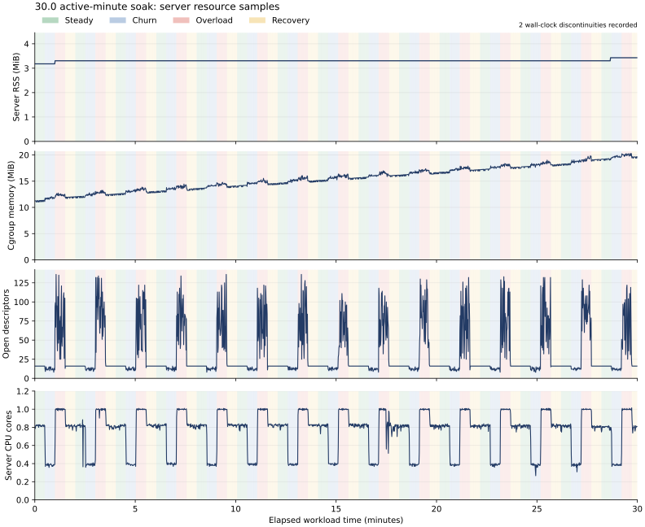
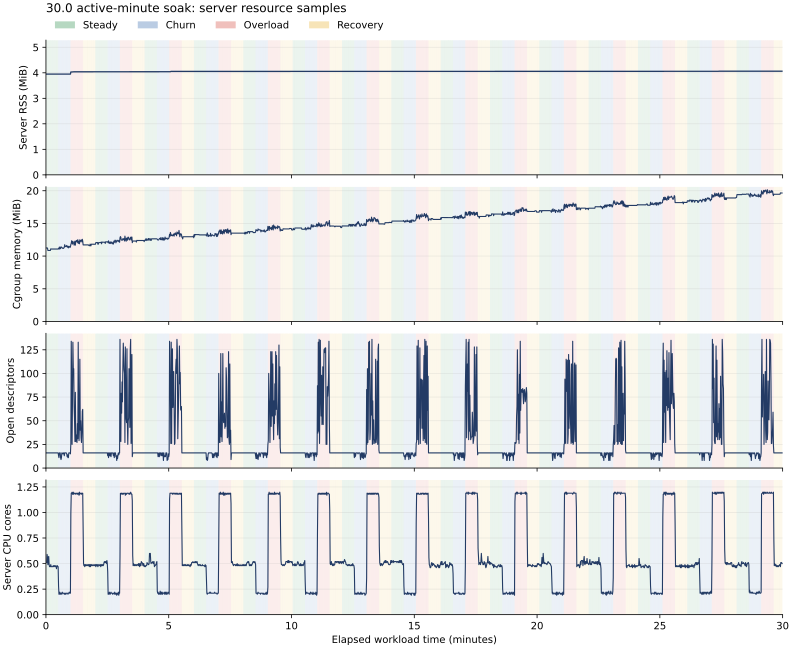

# Follow-up evidence

These experiments address hosted CI, client/server CPU separation, mostly idle
connections, Linux profiling and longer reliability testing. The server implementation
is unchanged; the changes are validation and observability tools.

## Hosted CI

The CI workflow now supports manual dispatch and retains test and fuzz artifacts.
The [hosted run for the experiment tools](https://github.com/Mei0707/High-Performance-C-HTTP-Server/actions/runs/39843244988)
reports success. Release, ASan/UBSan and TSan each run the parser/component suite, real
server integration tests, baseline integration and measurement-integrity checks. The
remaining jobs exercise libFuzzer and a clean Docker build. See the saved
[CI metadata](../../../docs/validation/hosted-ci.json), which records successful
conclusions for all five jobs and their individual steps.

## Separate CPU sets: small responses

The server used CPUs 0–3 and the wrk client CPUs 4–7 in separate containers on one
ten-vCPU Linux VM. Every /hello body was validated through the same Lua callback.
Each architecture received a two-second warm-up followed by three ten-second runs.
CPU below is sampled server process CPU or waited client process CPU; 100% means one core.

| Metric | Reactor | Thread per connection |
|---|---:|---:|
| Median validated HTTP 200/sec | 42,993 | 226,030 |
| Observed min–max HTTP 200/sec | 42,897–43,387 | 221,588–226,665 |
| Median reported p99 (ms) | 6.661 | 3.860 |
| Median server CPU | 120.7% | 392.6% |
| Median client CPU | 57.4% | 368.3% |
| Non-200 / corrupted bodies | 0 / 0 | 0 / 0 |
| wrk timeout counter, all runs | 0 | 109 |
| All runs passed strict validation | yes | no |

The baseline's first run reported 109 timeouts; the other two reported zero. Its data
is retained and its controller exits unsuccessfully. The rates above count completed
HTTP 200 responses, including late responses. In wrk 4.1.0, a completed response can also
increment the timeout counter when its latency cannot be recorded in the configured
histogram. The counts can overlap, and its p99 excludes such overflow values. See
[wrk's response_complete implementation](https://github.com/wg/wrk/blob/4.1.0/src/wrk.c).
No root cause is established for those outliers. This is evidence of high completed
throughput and a reliability qualification, rather than an error-free capacity claim.

The baseline uses nearly all four assigned server cores, while the reactor consumes
about 1.2. The measurements expose a constraint in the reactor path for tiny handlers.
The baseline client also approaches its four-core budget, so a stronger load generator
would be needed to establish its ultimate capacity. CPU affinity separates the two
measured processes but does not exclude unrelated host workloads. This topology shares
memory, cache, network and a hypervisor; it is not a measurement across independent
physical hosts.

Raw results: [reactor client](dedicated/reactor/client/client.json),
[baseline client](dedicated/baseline/client/client.json), and their
[reactor](dedicated/reactor/server/server-samples.jsonl) /
[baseline](dedicated/baseline/server/server-samples.jsonl) process telemetry.

## Two thousand mostly idle connections

Both servers admitted and retained all 2,000 sockets. One percent were pulsed every
two seconds; every original socket was checked again after the 30-second hold.
The CPU sets, 512 MiB memory limit, 4096-task limit and descriptor limits matched.

| Hold measurement | Reactor | Thread per connection |
|---|---:|---:|
| Established / survived | 2,000 / 2,000 | 2,000 / 2,000 |
| Server threads | 5 | 2,001 |
| Server CPU | 0.85% | 54.44% |
| Peak server RSS | 4.68 MiB | 30.32 MiB |
| Peak cgroup memory | 18.05 MiB | 95.86 MiB |
| Peak reserved virtual memory | 295.5 MiB | 20.69 GiB |
| Open descriptors after cleanup / before | 8 / 8 | 6 / 6 |

This workload demonstrates the resource advantage sought by the proposal. Virtual
reservation measures address space; RSS and cgroup memory capture other aspects of
memory use. Cgroup memory also includes the monitor, charged file cache and kernel
allocations. Results cover a 30-second hold, with longer behavior assessed separately.

Raw results: [reactor](idle-2000/reactor/client/client.json),
[baseline](idle-2000/baseline/client/client.json), and [computed comparisons](comparisons.json).

## Linux perf evidence

Both architectures were profiled with O2, symbols and frame pointers, using a 15-second
wrk measurement after warm-up. The collector also spans warm-up and the drain interval.
Software task-clock, context-switch, migration and fault counters are saved as interval
CSV. CPU-clock sampling at 99 Hz retains DWARF call chains; the flat text report uses
self sample percentages and a 0.5% display threshold. No samples were reported lost.

Selected reactor samples:

| Symbol | Self samples |
|---|---:|
| try_to_wake_up | 18.80% |
| finish_task_switch | 8.62% |
| sock_def_readable | 8.47% |
| el0_svc | 6.61% |
| epoll_ctl (libc) | 3.05% |
| do_epoll_ctl (kernel) | 2.90% |
| HttpParser::parse_headers | 0.74% |
| malloc | 0.52% |

The baseline's largest individual symbol was __schedule at 25.07%. These profiles
put scheduler wakeups, socket work and syscall transitions ahead of the displayed
allocation function. Wakeups include both network I/O and worker handoff; the profile
does not assign all wakeup cost to the task queue. malloc alone also does not represent
every allocation-related cost.

A useful next controlled optimization is removing the duplicate epoll modification
when read dispatch transitions into processing, then measuring completion-notification
batching. These are hypotheses for a later change. No improvement is claimed from a
profile alone, and profiled O2 rates should be assessed separately from the O3 load runs.

Raw artifacts: [reactor report](perf/reactor/server/perf-report.txt),
[baseline report](perf/baseline/server/perf-report.txt),
[reactor counters](perf/reactor/server/perf-stat.csv),
[baseline counters](perf/baseline/server/perf-stat.csv), and each server directory's
compressed perf.data and exact profiled executable.

## Soak testing

The initial run exposed a load-generator confound: it performed hostname resolution
for every new connection. The client network namespace had emitted 10,865,668 UDP
datagrams when inspected. The interrupted run recorded two overload request timeouts;
their I/O stage was not captured, so DNS is a possible contributor rather than an
established cause. Its streamed windows include the partial final phase, while the
client summary is the last completed-phase checkpoint. Both are retained in
[soak-initial-dns](soak-initial-dns/).

The refined client resolves the IPv4 target once before measurement, keeps the same
five-second timeout, and records the I/O stage of future errors. Successful and failed
latencies remain separate. It streams fixed-size histograms and TCP namespace counters
instead of retaining all per-request timings.

The local soak reserved CPU 8 for the server and CPU 9 for the client, with one
worker, a 16-task queue, eight regular connections and 128 overload connections.
The rerun completed **1,800.012 seconds of monotonic workload time**, with
38,616,662 HTTP 200 responses, 3,876,886 expected overload HTTP 503 responses, and
**12 header-read timeouts** in one overload window. It therefore **failed** the strict
error criterion. RSS stayed within 3,256–3,512 KiB, sampled cgroup memory peaked at
20.27 MiB, and descriptors returned from 8 to 8. Cgroup memory rose from about
11 MiB to 20 MiB while the telemetry file itself grew to 7.66 MiB. This scope
includes the monitor, kernel allocations and charged file cache; it is not a flat
whole-container memory trace, and RSS stability does not explain every cgroup charge.
The captured server metrics reported
zero server processing timeouts, parse errors, handler errors, stale completions and
write errors at the diagnostic point. Client scheduling, network and server response
delivery remain possible contributors to header-read timeouts; no specific cause is
established by those counters.

The local VM also recorded two wall/monotonic discontinuities totaling about 948.4
seconds. Thus this is 30 active minutes with a wall-clock qualification, rather than
continuous availability evidence. New tooling acquires a scoped macOS idle-sleep
assertion, records explicit monotonic client intervals, audits clock changes, and
rejects materially inconsistent wrk timing. Nothing changes persistent power settings.

Raw local results: [client outcome](soak-30min/reactor/client/client.json),
[server samples](soak-30min/reactor/server/server-samples.jsonl),
[client windows](soak-30min/reactor/client/client-windows.jsonl),
[clock audit](soak-30min/reactor/clock-audit.json), and
[server metric diagnostic](soak-30min/reactor/metrics-diagnostic.txt).

The independent [hosted Linux soak](https://github.com/Mei0707/High-Performance-C-HTTP-Server/actions/runs/39843335754)
**passed** all workload, controller, clock and descriptor-recovery checks. It completed
1,800.001 seconds with **27,691,060 HTTP 200 responses**, **3,487,034 expected overload
HTTP 503 responses**, and **zero unexpected errors**. Every streamed window agrees with
the final phase totals. RSS ranged from 4,024 to 4,160 KiB (3.93–4.06 MiB), descriptors
returned from 8 to 8, and no wall/monotonic discontinuity over one second was detected.
Cgroup memory ranged from 10.80 to 20.15 MiB, again including monitoring and file-cache
charges rather than only the server's resident pages.

This run used an x86_64 hosted Linux runner: server CPUs 0–1, client CPUs 2–3,
an optimized O2 build with symbols, and the same phase pattern, queue and connection
counts as the local soak. Its different CPU allocation, platform and environment mean
it does not establish the cause of the local timeouts. Its temporary branch adds only
a branch-scoped push trigger to the optional experiment workflow. The full artifact ZIP
matched GitHub's recorded SHA-256 before extraction; see [provenance](hosted-soak/provenance.json).

Raw hosted results: [client outcome](hosted-soak/reactor/client/client.json),
[resource samples](hosted-soak/reactor/server/server-samples.jsonl),
[client windows](hosted-soak/reactor/client/client-windows.jsonl), and
[clock audit](hosted-soak/reactor/clock-audit.json).

Reproduction commands and precise metric scopes are in the
[experiment guide](../../../docs/experiments.md). Longer multi-hour soaks, native Linux
storage and measurements across physical client/server hosts remain further work.
