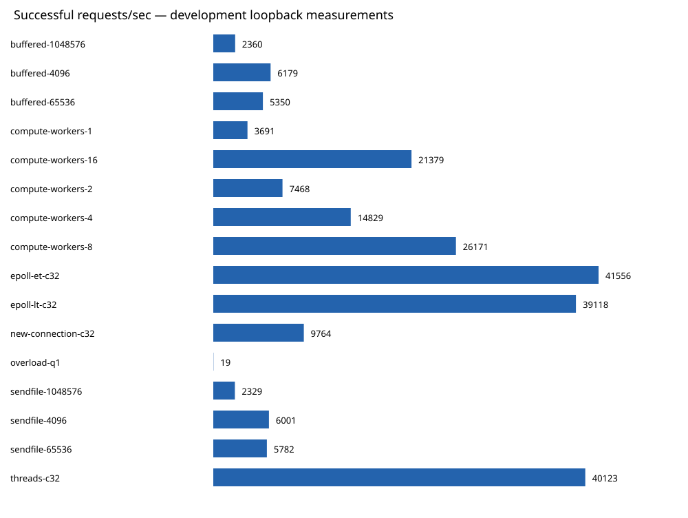

# Measured loopback results

Each row summarizes repeated runs. Rates count HTTP 200 responses; errors are reported separately.
The Python client shares CPU with the server; these are development measurements, not capacity claims.

| Configuration | Median successful req/s | Min–max req/s | Median p99 ms | Errors (all runs) | Median peak RSS KiB |
|---|---:|---:|---:|---:|---:|
| buffered-1048576 | 2359.8 | 2227.2–2366.1 | 23.863 | 0 | 49244 |
| buffered-4096 | 6179.3 | 6005.1–6246.7 | 8.498 | 0 | 3384 |
| buffered-65536 | 5350.3 | 5293.5–5477.0 | 12.574 | 0 | 6088 |
| compute-workers-1 | 3690.9 | 3566.8–3693.7 | 9.083 | 0 | 3256 |
| compute-workers-16 | 21378.7 | 21264.3–21592.1 | 4.168 | 0 | 3512 |
| compute-workers-2 | 7468.0 | 7465.3–7527.5 | 5.743 | 0 | 3256 |
| compute-workers-4 | 14829.3 | 14570.4–14952.2 | 3.727 | 0 | 3384 |
| compute-workers-8 | 26171.1 | 25723.5–27455.4 | 2.762 | 0 | 3384 |
| epoll-et-c32 | 41556.2 | 39676.1–41665.0 | 1.449 | 0 | 3384 |
| epoll-lt-c32 | 39117.6 | 38901.9–39495.0 | 1.780 | 0 | 3384 |
| new-connection-c32 | 9764.1 | 9700.3–9835.1 | 4.904 | 0 | 3384 |
| overload-q1 | 19.2 | 19.2–19.2 | 109.567 | 60840 | 3256 |
| sendfile-1048576 | 2328.5 | 2320.2–2639.6 | 27.620 | 0 | 3384 |
| sendfile-4096 | 6001.4 | 5950.2–6053.1 | 9.110 | 0 | 3384 |
| sendfile-65536 | 5781.5 | 5365.8–5924.4 | 9.294 | 0 | 3384 |
| threads-c32 | 40122.8 | 39412.3–41377.5 | 1.826 | 0 | 3256 |

Raw inputs:

- [buffered-1048576.json.gz](raw/buffered-1048576.json.gz)
- [buffered-4096.json.gz](raw/buffered-4096.json.gz)
- [buffered-65536.json.gz](raw/buffered-65536.json.gz)
- [compute-workers-1.json.gz](raw/compute-workers-1.json.gz)
- [compute-workers-16.json.gz](raw/compute-workers-16.json.gz)
- [compute-workers-2.json.gz](raw/compute-workers-2.json.gz)
- [compute-workers-4.json.gz](raw/compute-workers-4.json.gz)
- [compute-workers-8.json.gz](raw/compute-workers-8.json.gz)
- [epoll-et-c32.json.gz](raw/epoll-et-c32.json.gz)
- [epoll-lt-c32.json.gz](raw/epoll-lt-c32.json.gz)
- [new-connection-c32.json.gz](raw/new-connection-c32.json.gz)
- [overload-q1.json.gz](raw/overload-q1.json.gz)
- [sendfile-1048576.json.gz](raw/sendfile-1048576.json.gz)
- [sendfile-4096.json.gz](raw/sendfile-4096.json.gz)
- [sendfile-65536.json.gz](raw/sendfile-65536.json.gz)
- [threads-c32.json.gz](raw/threads-c32.json.gz)
