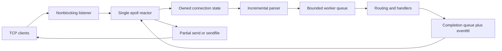

# Architecture

The reactor alone accepts, reads, writes, closes and changes epoll interest. `UniqueFd`
provides move-only ownership of sockets, files, epoll, eventfd and signalfd descriptors.
Workers receive an owned request and return an owned response. They never receive the
connection pointer or socket descriptor.

Every accepted connection receives a monotonically increasing 64-bit identity. Epoll
events and completions carry that identity. The reactor finds the connection and verifies
its processing state before attaching a response. File descriptor reuse cannot deliver a
response to a different client. Processing timeouts force close after the error response,
so an old completion cannot match a later request on the same connection.

Connection states are reading, processing and writing. A parser locates the end of the
header incrementally, validates it once, then waits for the declared body length. Its
consumed count leaves subsequent pipelined requests in the input buffer. Input uses a
consumed offset and compacts when useful. Output uses an offset through partial sends.
Sendfile responses retain a file descriptor and offset instead of an entire file buffer.

The listener uses level triggering and accepts up to 128 clients per turn. Client I/O has
a 256 KiB fairness budget. LT is the default. ET re-arms with `EPOLL_CTL_MOD`, including
when stopping before EAGAIN or resuming paused input, so kernel readiness is re-evaluated.
EPOLLOUT is enabled only while output is pending.

An eventfd wakes the reactor on completion. SIGINT and SIGTERM are blocked before worker
creation and read through signalfd. A monotonic deadline sweep every 50 ms enforces timeouts;
its linear scan is intentionally straightforward. Metrics use atomics, the router is frozen,
and access logs use a bounded queue with a dedicated writer. Producers drop logs on queue
saturation or mutex contention and increment a drop counter.
